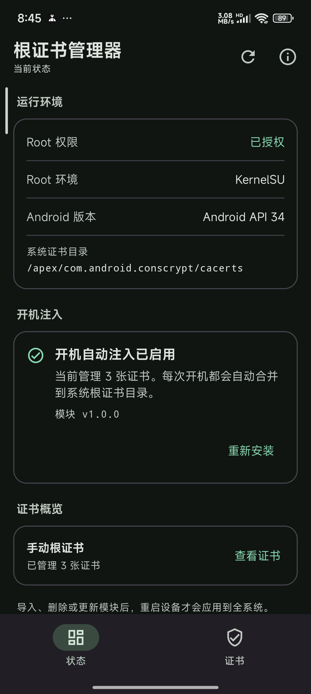
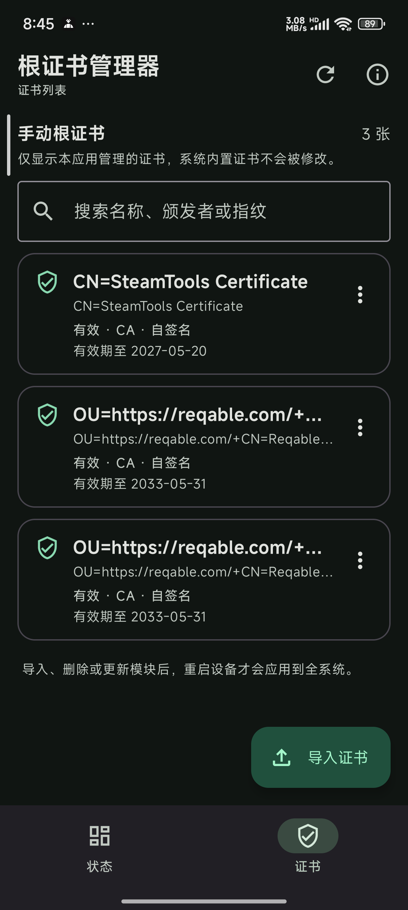

# 根证书管理器

一个面向已 Root 设备的 Android 系统根证书管理工具。界面使用 Jetpack Compose 与 Material 3，Root 能力通过 `su` 获取，开机注入由内置的 KernelSU 模块完成。

## 界面示例

| 状态 | 证书 |
| --- | --- |
|  |  |

截图中的证书仅用于演示。

## 功能

- 启动时检测 `su`，未获得 Root 权限时阻止进入管理界面。
- 底部导航分为“状态”和“证书”两个页面。
- 一键安装、更新或修复 KernelSU 开机注入模块。
- 导入 `.crt`、`.pem`、`.0`、`.p12` / `.pfx` 证书，也支持包含多张证书的 PEM 文件。
- 自动提取 PKCS#12 中的 CA 证书；私钥不会被保存或导出。
- 计算 Android 使用的 OpenSSL `subject_hash_old` 文件名，并处理同哈希时的 `.0`、`.1` 等冲突。
- 管理列表仅展示由本应用导入的证书，系统内置证书不会被修改。
- 查看证书详情、搜索、导出 PEM、删除证书。
- 支持 Android 8.0（API 26）及以上；Android 14+ 使用 Conscrypt APEX 注入逻辑。

## 环境要求

- Android 8.0 及以上。
- KernelSU 或兼容的标准 Root 模块机制。
- 必须允许本应用使用 `su`。
- 构建环境：JDK 22、Android SDK 37、Gradle Wrapper。

## 构建

```powershell
.\gradlew.bat :app:assembleDebug
.\gradlew.bat :app:testDebugUnitTest
.\gradlew.bat :app:lintDebug
```

调试 APK：

```text
app/build/outputs/apk/debug/app-debug.apk
```

构建可安装的 Release APK：

```powershell
.\gradlew.bat :app:assembleRelease
```

输出：

```text
app/build/outputs/apk/release/app-release.apk
```

当前 Release 构建使用本机 Android 调试签名，便于侧载测试。正式发布前请替换为自己的长期签名密钥。

安装到已连接设备：

```powershell
adb install -r app\build\outputs\apk\release\app-release.apk
```

生成可手动刷入的 KernelSU 模块 ZIP：

```powershell
.\gradlew.bat :app:packageKsuModule
```

输出：

```text
app/build/outputs/ksu-module/RootCertificateManager-KernelSU.zip
```

该 ZIP 用于手动安装模块，不包含证书。正常使用时推荐直接在 App 的“状态”页安装模块。

## 持续集成

仓库包含两个 GitHub Actions 工作流：

- `Android CI`：在推送到 `main`、提交 Pull Request 或手动触发时，运行单元测试、Lint、Debug 构建和 KernelSU 模块打包，并上传 APK、模块 ZIP 与测试报告。
- `KernelSU Module Validation`：检查模块 Shell 脚本的语法与 ShellCheck 规则、拒绝 CRLF 换行、验证模块 ID，并生成模块 ZIP。

工作流文件位于 `.github/workflows/`。

## 使用流程

1. 打开 App，在 KernelSU 中授予 Root 权限。
2. 在“状态”页安装开机注入模块。
3. 切换到“证书”页，导入一个或多个证书文件；PKCS#12 会要求输入密码。
4. 导入完成后重启设备。
5. 在“设置 -> 安全 -> 加密与凭据 -> 信任的凭据 -> 系统”中检查证书。

删除证书或在 App 中更新模块后，同样需要重启才会从全系统信任库中移除或更新。

## 工作原理

### 证书转换

1. 使用 Android `CertificateFactory` / `PKCS12` KeyStore 解析输入。
2. 只保留 CA 证书（`basicConstraints: CA:TRUE`）或自签名根证书。
3. 按 OpenSSL `subject_hash_old` 算法计算文件名：
   - 对证书的 Subject DER 计算 MD5；
   - 前 4 字节按小端 32 位整数格式化；
   - 文件名为 `<hash>.0`，哈希冲突时递增为 `<hash>.1` 等。
4. 将证书统一编码为 PEM，写入模块的 `system/etc/security/cacerts` 目录。

### Android 13 及以下

依赖 KernelSU 的模块系统叠挂能力，将模块内的 `system/etc/security/cacerts` 合并到系统证书目录。

### Android 14 及以上

Android 14 将运行时系统信任库移到了只读的 Conscrypt APEX：

```text
/apex/com.android.conscrypt/cacerts
```

模块启动脚本会：

1. 从 APEX 复制原始系统证书到临时证书库；
2. 追加本模块管理的所有证书，并处理文件名冲突；
3. 修正权限与 SELinux 上下文；
4. 通过 `nsenter` 将临时证书库绑定到 init 与 Zygote 的挂载命名空间；
5. `service.sh` 在开机后再次检查并补齐 Zygote 注入。

因此，开机后新启动的应用会从 Zygote 继承包含新证书的证书视图。

模块注入日志：

```text
/data/local/tmp/root_cert_manager.log
```

也可以在 App 的“关于与帮助”中直接查看。

## 目录结构

```text
app/src/main/java/com/daijunhao/certificatemanager/
├── data/cert/      证书解析、哈希、文件存储
├── data/module/    KernelSU 模块安装
├── data/root/      su 命令与 Root 环境检测
└── ui/             Material 3 Compose 界面与 ViewModel

app/src/main/assets/kernelsu/
├── module.prop
├── post-fs-data.sh
├── service.sh
├── apex-inject.sh
├── uninstall.sh
└── system/etc/security/cacerts/
```

模块运行时的证书目录：

```text
/data/adb/modules/root_cert_manager/system/etc/security/cacerts
```

## 安全说明

- 只导入你明确信任的根证书。拥有对应私钥的人可以解密或篡改经过该设备的 TLS 流量。
- 本应用没有网络权限，不会上传证书。
- PKCS#12 只在内存中解析，只持久化证书，不持久化私钥。
- 应用已关闭 Android 备份。
- Root 操作具有高权限风险；请只在自有或获授权管理的设备上使用。

## 已知限制

- 证书改动、模块安装与启用均在下次重启后生效。
- 使用证书锁定（certificate pinning）或自带 TrustStore 的应用不受系统根证书影响。
- 部分 OEM 系统可能修改 APEX 路径或挂载策略；可在 App 中查看注入日志定位。
- 若 KernelSU 为目标应用启用了“卸载模块（umount modules）”，该应用可能看不到模块提供的证书。

## 验证状态

- `assembleDebug`、`assembleRelease` 构建通过。
- 8 个单元测试通过，覆盖 PEM/DER 解析、PKCS#12 密码、重复证书、错误文件及 `subject_hash_old` 与 OpenSSL 的对照。
- `lintDebug` 通过；仅保留依赖有更新版本的提示。
- Release APK 已通过 `adb` 安装并在 Android 14（API 34）设备上启动。
- 已在 Android 14 实机确认 APEX 证书合并和 init 挂载命名空间可见。

## 许可证

本项目采用 [PolyForm Noncommercial License 1.0.0](LICENSE) 并附加源码共享与禁止倒卖条款：

- 禁止销售、转售，或将其作为付费产品或服务的一部分分发。
- 修改后的版本被发布或以网络服务形式提供时，必须按相同许可证公开完整对应源代码。
- 必须保留许可证与版权声明。

由于包含非商业限制，本项目属于源码公开（source-available）项目，不是 OSI 定义的开源许可证。
